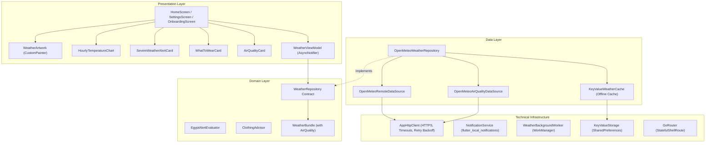

# طقس • Taqs

[](https://flutter.dev)
[](https://dart.dev)
[](https://riverpod.dev)
[](LICENSE)
[](.github/workflows/ci.yml)

> **طقس (Taqs)** is an Arabic-first, production-grade weather application crafted specifically for Egypt. Designed with deep navy atmospheric aesthetics, strict type safety, Feature-First Clean Architecture, live Open-Meteo meteorological data, GPS & governorate selection, offline stale-while-revalidate caching, 12-hour periodic background weather briefings, and full RTL/LTR internationalization.

---

## 📸 Screenshots & Visual Experience

| Arabic Dark (Hero) | English Light | Onboarding & Permissions | Hourly Curve & Artwork |
| :---: | :---: | :---: | :---: |
| *(Screenshot Placeholder)*<br>`assets/screenshots/home_dark_ar.png` | *(Screenshot Placeholder)*<br>`assets/screenshots/home_light_en.png` | *(Screenshot Placeholder)*<br>`assets/screenshots/onboarding_ar.png` | *(Screenshot Placeholder)*<br>`assets/screenshots/details_chart_ar.png` |

---

## 🌟 Key Features

### 1. Brand Identity & Vector System
- **Original Vector Mark**: Seamless integration of the Arabic glyph **"ط"** (from **طقس**) with a golden celestial solar horizon arc, rendered in electric blue, cyan, and metallic gold on a deep navy base (`#0B111E`).
- **Adaptive App Icons**: Android adaptive icons (split foreground, background, and monochrome Android 13+ themed icon), plus high-resolution iOS launcher assets.
- **Native & In-App Splash**: Eliminates blank white flashes during cold boots via `flutter_native_splash`, transitioning smoothly to the in-app animated vector reveal.

### 2. Atmospheric Visual Layer & Custom Painters
- **Multi-Stop Dynamic Sky**: Real-time atmospheric background gradients shifting gracefully between Clear Day, Clear Night, Cloudy, Rain, Fog, and Sandstorm states.
- **Custom-Painted Weather Artwork (`WeatherArtwork`)**: Bespoke animated meteorological illustrations (Sun, Moon, Clouds, Rain, Fog, Dust) running at 60fps inside isolated `RepaintBoundary` wrappers without third-party asset bloat.
- **Hourly Temperature Curve (`HourlyTemperatureChart`)**: Custom cubic Bézier temperature curve plotting real 24-hour temperature gradients with interactive point highlights.
- **7-Day Forecast with Range Bars**: Horizontal temperature range bars visualizing weekly lows and highs relative to the week's extreme spectrum.
- **Celestial Solar Arc (`SunriseSunsetArc`)**: Real-time celestial trajectory tracking the sun's position across the horizon from dawn to dusk.

### 3. First-Launch Onboarding & Permission Grace
- **3-Step Contextual Flow**: Welcome & value pitch, Location permission rationale, and 12-Hour Weather Notification permission.
- **Non-Intrusive Recovery**: Graceful handling of granted, denied, and `deniedForever` states. Never locks the app—users can always fallback to manual governorate selection.
- **`PermissionRecoveryBanner`**: A subtle, dismissible banner on Home offering one-tap access to device app settings when permissions are missing.

### 4. 12-Hour Weather Notifications
- **Periodic Background Worker**: Standalone background execution powered by `workmanager` running every ~12 hours.
- **Real Meteorological Briefings**: Formats actual city name, temperature, daily high/low, condition summary, and actionable dressing advice (e.g., *"القاهرة: 28°، مشمس — العظمى 31° والصغرى 19° — أجواء معتدلة ومناسبة للخروج"*).
- **Settings Controls**: Toggles for daily briefings and severe hazard alerts, paired with an instant **"Send test notification now"** trigger.
- **Realistic Platform Transparency**:
  - *Android*: WorkManager relies on JobScheduler/AlarmManager; exact delivery times are approximate due to Android Doze mode and manufacturer battery savers.
  - *iOS*: Background tasks depend on iOS Background App Refresh heuristics. As best practice, scheduled local notifications are synchronized whenever the app is opened or background-fetched.

### 5. Smart Domain Engines
- **"What to Wear Today?" (`ClothingAdvisor`)**: Deterministic engine translating temperature, humidity, wind speed, rain chance, and UV index into seasonal clothing guidance and umbrella/sun protection tips.
- **Air Quality Index (`AirQualityCard`)**: Queries Open-Meteo Air Quality API to compute European Air Quality Index (EAQI), PM2.5, PM10, and desert dust concentration with localized health precautions.
- **Egypt Weather Alerts (`EgyptAlertEvaluator`)**: Real-time detection of Khamsin dust storms (الخماسين), dense morning highway fog (الشبورة المائية), extreme heatwaves (38°C+), and torrential rain.

---

## 🔒 Permissions & Privacy Commitment

| Permission | Platform | Rationale | Privacy Guarantee |
| :--- | :--- | :--- | :--- |
| `ACCESS_FINE_LOCATION`<br>`ACCESS_COARSE_LOCATION` | Android & iOS | Fetch local meteorological metrics for user's immediate coordinates | GPS coordinates are processed **strictly on-device**. Coordinates are transmitted directly to the Open-Meteo API for forecast queries and never stored on remote servers or tracked. |
| `POST_NOTIFICATIONS` | Android 13+ & iOS | Deliver 12-hour periodic weather updates and urgent severe hazard warnings | No push marketing or third-party ad services. Notifications are generated locally. |
| `RECEIVE_BOOT_COMPLETED` | Android | Re-register WorkManager 12-hour periodic jobs after device reboots | Solely used by WorkManager to maintain scheduled background briefings. |

---

## 🎨 Branding Regeneration

All branding assets, launcher icons, and splashes can be regenerated reproducibly using:

```bash
# 1. Regenerate vector-derived launcher icon PNGs
dart run tool/generate_brand_assets.dart

# 2. Build platform adaptive and iOS icons
dart run flutter_launcher_icons

# 3. Recreate native splash screens (Android 12+ & iOS)
dart run flutter_native_splash:create
```

---

## 🏗️ Architecture

The codebase follows **Feature-First Clean Architecture** with **MVVM** in presentation:



---

## 🛠️ Tech Stack

- **Framework**: [Flutter 3.47+](https://flutter.dev) (Dart 3.13+)
- **State Management**: [flutter_riverpod 3.4.3](https://pub.dev/packages/flutter_riverpod)
- **Routing**: [go_router 18.0.2](https://pub.dev/packages/go_router)
- **Networking**: `http 1.6.0` with custom retry backoff & timeout client
- **Background Tasks**: `workmanager 0.10.10`
- **Notifications**: `flutter_local_notifications 22.3.2`
- **Location & Permissions**: `geolocator 14.1.1`
- **Storage**: `shared_preferences 2.5.6`
- **Sharing**: `share_plus 13.3.1`
- **Internationalization**: `flutter_localizations` & `intl 0.20.3`
- **Typography & Icons**: Cairo font family & Cupertino/Material icons
- **Utilities**: `url_launcher 6.3.3`, `package_info_plus 10.2.2`
- **Analysis & Testing**: `very_good_analysis 11.0.0`, `mocktail 1.0.5`, `flutter_test` (65+ passing unit & widget tests)

---

## ⛅ Weather Data Attribution

Weather forecast, air quality, and geocoding data are provided by **[Open-Meteo.com](https://open-meteo.com)** under a non-commercial open data license.

---

## 🚀 Getting Started

Follow these steps to run the app locally:

1. **Clone the repository**:
   ```bash
   git clone https://github.com/AhmedELmansy1/taqs.git
   cd taqs
   ```

2. **Install dependencies**:
   ```bash
   flutter pub get
   ```

3. **Verify analyzer and test suite**:
   ```bash
   dart analyze .
   flutter test
   ```

4. **Launch the application**:
   ```bash
   flutter run
   ```

---

## 👨‍💻 About the Developer

**Ahmed Elmansy (أحمد المنسي)**  
*Flutter Developer • Cybersecurity • AI*  
- 📍 **Location**: Sharqia, Egypt  
- 🎓 **Education**: Bachelor's in Computer Science and Information, Benha University  
  - *Specialization*: Information Security & Digital Forensics (Grade: Very Good)  
  - *Graduation Project*: Forgery Detection (AI-powered image/audio forgery detection) — Grade: Excellent  
- 🛠️ **Technical Focus**: Flutter, Dart, Python, FastAPI, UI/UX, REST APIs, Git, GitHub, AI/ML, Cybersecurity, Digital Forensics  
- 📂 **Projects**: Shoot Live, Forests Team, Mansy Store, ITI Flutter Project (Clean Architecture, BLoC, Gemini AI, Wishlist), Forgery Detection  
- 📧 **Email**: [ahmedelmansy1311@gmail.com](mailto:ahmedelmansy1311@gmail.com)  
- 📞 **Phone**: [+20 106 799 5211](tel:+201067995211)  
- 💼 **LinkedIn**: [linkedin.com/in/ahmed-elmansy](https://www.linkedin.com/in/ahmed-elmansy-a6b494346)  
- 🐙 **GitHub**: [github.com/AhmedELmansy1](https://github.com/AhmedELmansy1)  

---

## 📄 License

This project is licensed under the MIT License — see the [LICENSE](LICENSE) file for details.
