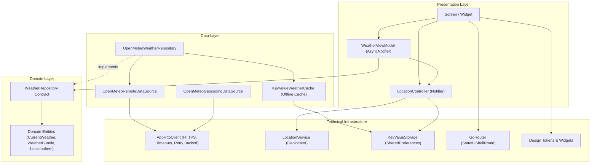

# طقس • Taqs

[](https://flutter.dev)
[](https://dart.dev)
[](https://riverpod.dev)
[](LICENSE)
[](.github/workflows/ci.yml)

> **طقس (Taqs)** is an Arabic-first, production-grade weather application crafted specifically for Egypt. Designed with deep navy atmospheric aesthetics, strict type safety, Feature-First Clean Architecture, live Open-Meteo meteorological data, GPS & governorate selection, offline stale-while-revalidate caching, and full RTL/LTR internationalization.

---

## 🌟 Project Roadmap

While global weather apps treat the Middle East as an afterthought, **طقس (Taqs)** is purpose-built to address Egypt's unique meteorological patterns and cultural context.

### Phase 1 (Foundation) — Completed ✅
- [x] **Architecture & State Foundation**: Feature-first Clean Architecture, Riverpod state management & DI, and GoRouter navigation with persistent bottom navigation shell.
- [x] **Design System (`lib/core/design`)**: Calm, premium deep navy palette, electric blue and cyan accents, metallic-gold highlights, accessible contrast, responsive breakpoints, and Cairo typography.
- [x] **Arabic-First Localization**: Native Arabic default with complete RTL support, dynamic English switching, and local preference persistence via SharedPreferences.
- [x] **Developer Showcase**: Dedicated, verified profile page for **Ahmed Elmansy** with contact actions and platform integrations.

### Phase 2 (Data, Location & Caching) — Completed ✅
- [x] **Live Open-Meteo Integration**: `OpenMeteoRemoteDataSource` querying live forecast endpoint with WMO code mapping, DTOs, and clean domain entities.
- [x] **Geolocation & Egyptian Governorates**: `LocationService` with GPS permission handling, plus interactive search screen with quick-pick chips for all verified Egyptian governorates (Cairo, Giza, Alexandria, Sharqia, Dakahlia, Gharbia, Qalyubia, Port Said, Suez, Ismailia, Luxor, Aswan, Red Sea, South Sinai, etc.).
- [x] **Offline Caching & Stale-While-Revalidate**: Instant display of cached weather snapshots, background network synchronization, and non-intrusive offline banners ("Last updated X ago") when network is down.
- [x] **Attribution & Transparency**: Prominent attribution to Open-Meteo in Settings, About, and documentation.

### Phase 3 Roadmap — Next Up ⏳
- [ ] **Egypt-Specific Severe Alerts**: Early warning indicators for dust storms (الخماسين), dense morning highway fog (الشبورة المائية), heat waves, and localized torrential rain.
- [ ] **"What Should I Wear?" Advisor**: Contextual daily clothing recommendations tailored to Egypt's climate and humidity.
- [ ] **Air Quality Index (AQI)**: Particulate matter monitoring (PM2.5 / PM10) for Egyptian industrial and desert corridors.
- [ ] **Local Notifications & Home Screen Widget**: Morning digest notifications and glanceable Android/iOS home widgets.

---

## 🏗️ Architecture

The codebase follows **Feature-First Clean Architecture** with **MVVM** in presentation:



### Folder Layout
```text
lib/
├── app.dart                   # Root MaterialApp with router & theme setup
├── main.dart                  # Async initialization & ProviderScope overrides
├── l10n/                      # ARB localization sources (app_ar.arb, app_en.arb)
├── core/
│   ├── constants/             # App naming, default coordinates & storage keys
│   ├── design/                # Tokens, Typography (Cairo), Theme, Components
│   ├── errors/                # Sealed AppFailure hierarchy & ErrorLocalizer
│   ├── localization/          # LocaleController & language switching
│   ├── navigation/            # GoRouter configuration & shell navigation
│   ├── network/               # AppHttpClient (timeouts, retry backoff, HTTPS)
│   ├── permissions/           # LocationService contract & Geolocator implementation
│   ├── storage/               # KeyValueStorage contracts & implementations
│   └── theme/                 # ThemeController (Light / Dark / System)
└── features/
    ├── about/                 # Developer profile presentation & model
    ├── location/              # LocationItem, Geocoding DTO, Governorates & Controller
    ├── settings/              # Appearance, language preferences & attribution
    ├── splash/                # Initial boot & splash screen
    └── weather/               # Domain entities, repo contracts, cache, DTOs, widgets
```

---

## 🛠️ Tech Stack

- **Framework**: [Flutter 3.47+](https://flutter.dev) (Dart 3.13+)
- **State Management**: [flutter_riverpod 3.4.3](https://pub.dev/packages/flutter_riverpod)
- **Routing**: [go_router 18.0.2](https://pub.dev/packages/go_router)
- **Networking**: `http 1.6.0` with custom retry backoff & timeout client
- **Location & Permissions**: `geolocator 14.1.1`
- **Storage**: [shared_preferences 2.5.6](https://pub.dev/packages/shared_preferences)
- **Internationalization**: `flutter_localizations` & `intl 0.20.3`
- **Typography & Icons**: Cairo font family & Cupertino/Material icons
- **Utilities**: `url_launcher 6.3.3`, `package_info_plus 10.2.2`
- **Analysis & Testing**: `very_good_analysis 11.0.0`, `mocktail 1.0.5`, `flutter_test` (34 passing unit/widget tests)

---

## ⛅ Weather Data Attribution

Weather forecast and geocoding data are provided by **[Open-Meteo.com](https://open-meteo.com)** under a non-commercial open data license.

---

## 🚀 Getting Started

Follow these 4 simple steps to run the app locally:

1. **Clone the repository**:
   ```bash
   git clone https://github.com/AhmedELmansy1/taqs.git
   cd taqs
   ```

2. **Install dependencies**:
   ```bash
   flutter pub get
   ```

3. **Verify analyzer and test suite (34 passing tests)**:
   ```bash
   flutter analyze
   flutter test
   ```

4. **Launch the application**:
   ```bash
   flutter run
   ```

---

## 👨‍💻 About the Developer

**Ahmed Elmansy (أحمد المنسي)**  
*Flutter Developer • Cybersecurity • AI*  
- 📍 **Location**: Sharqia, Egypt  
- 🎓 **Education**: Bachelor's in Computer Science and Information, Benha University (Information Security & Digital Forensics)  
- 📧 **Email**: [ahmedelmansy1311@gmail.com](mailto:ahmedelmansy1311@gmail.com)  
- 💼 **LinkedIn**: [linkedin.com/in/ahmed-elmansy](https://www.linkedin.com/in/ahmed-elmansy-a6b494346)  
- 🐙 **GitHub**: [github.com/AhmedELmansy1](https://github.com/AhmedELmansy1)  

---

## 📄 License

This project is licensed under the MIT License — see the [LICENSE](LICENSE) file for details.
